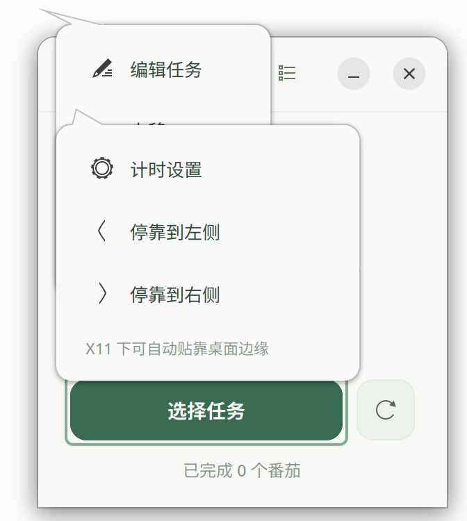
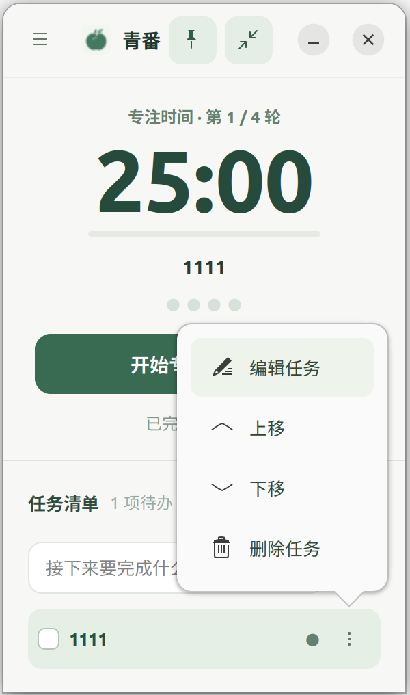
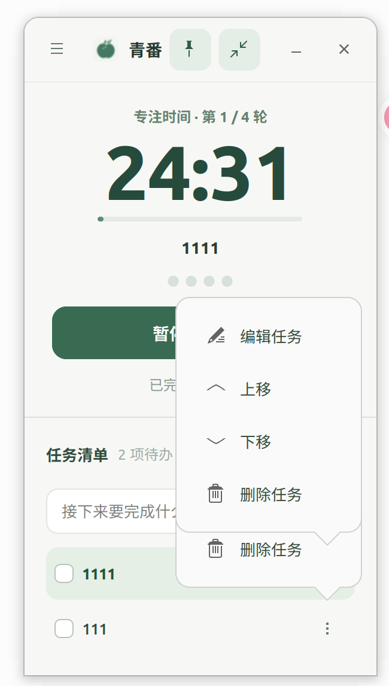

# 青番发布检查报告

检查日期：2026-10-19。范围：用户提供的三张截图、当前 Python / GTK 3 源码、模型测试、安装升级卸载脚本。

**结论：已完成主要交互修正和可执行的回归验证，尚不能签署正式发布。** 当前环境无法连接 X11 显示服务；GTK Broadway 备用显示服务也无法创建监听端口。因此没有新版本运行截图，没有真实鼠标拖动、窗口管理和视觉验收结果。以下截图均来自用户提交的旧版本，不是修复后的验证图。

## 截图证据与流程检查

### 1. 打开设置：有明显问题



设置菜单与任务菜单同时残留，遮住倒计时和主要操作。左右停靠增加了不必要的选择。源码中每次刷新任务与改变窗口高度均会触发重新贴边，用户拖动位置无法稳定保留。

修改：移除全部自动贴边逻辑和设置弹层；标题栏齿轮直接打开单一设置对话框，防止重复创建。保留原生标题栏拖动和图钉置顶请求。展开列表、修改任务不主动请求移动窗口。Wayland 的置顶能力取决于桌面管理器，跨次启动的位置交给桌面管理器处理。

### 2. 编辑与排序任务：操作过深



编辑、排序、删除均需先打开菜单，而且弹层大面积遮住窗口。任务名点击原先用于选择任务，不能直接编辑。

修改：任务名点击进入行内编辑；回车或失焦保存，Esc 取消，空白内容保留原名。拖柄支持鼠标排序及 Alt+↑/↓ 键盘替代操作。独立播放按钮选择专注任务，垃圾桶直接删除；可撤销最近一次删除，防止误操作。撤销在关闭后失效，连续删除时只保留最近一次。

### 3. 连续操作任务：存在发布阻断问题



截图可见多个任务菜单堆叠。源码刷新列表时只从容器移除控件，没有主动销毁；这为依附于行内按钮的弹层残留提供了条件。该解释来自源码检查，尚未在桌面上独立复现调用序列。

修改：移除任务弹层，并在重建任务列表时销毁旧行。新增对应 GUI 回归测试，待有显示服务时执行。

## 其他技术问题与处理

| 级别 | 问题及证据 | 处理 / 验证状态 |
| --- | --- | --- |
| P0 | GTK 3 与自动选择的 Gdk 4 冲突，原先启动即报错 | 显式指定 Gdk 3.0，模块导入已通过 |
| P0 | 非对象 JSON、异常 settings/tasks、NaN/Infinity 可触发加载或渲染异常 | 分字段校验并保留有效任务；异常原文件首次写回前备份；回归通过 |
| P1 | 任务 ID 重复导致操作目标不唯一 | 修复重复 ID，保留任务内容和原始备份；回归通过 |
| P1 | 读取失败被当作空数据，可能随后覆盖真实任务 | 读取权限错误向界面报告；不继续按空模型写入；模型回归通过，提示界面待验收 |
| P1 | 保存失败缺乏用户反馈 | 显示失败原因；关闭时保存失败阻止关闭；旧数据原子替换失败保护通过，提示界面待验收 |
| P1 | 删除没有恢复入口 | 一次删除撤销；删除当前任务暂停计时；GUI 回归待执行 |
| P1 | 修改运行阶段的设置后进度条分母随之变化 | 阶段时长独立保存，修改设置及重启均保留原计时基准；模型回归通过，界面待验收 |
| P1 | 安装目录含空格时桌面启动命令未正确引用 | 使用 KeyFile 生成并引用 Exec，隔离安装测试通过 |
| P2 | 暂停后的计时可以无确认重置 | 已经消耗过时间也要求确认，待桌面验收 |
| P2 | 小号辅助文字过浅，完成状态文字可读性不足 | 加深辅助文本颜色；实际主题、缩放和读屏仍待测试 |
| P2 | 定时回调未显式随窗口销毁取消 | 销毁窗口时移除回调，待 GUI 验收 |

## 已执行验证

运行 `/usr/bin/python3 -m unittest discover -s tests -v`：共 31 项，**23 项通过，8 项 GUI 测试因无可用图形显示服务明确跳过**。

已通过：原有任务和计时测试、4 轮专注长休息切换、重启暂停、数据读写兼容、双向拖动排序的模型逻辑、重排后重启、异常 JSON / 数值 / ID 防护、损坏原文件备份、原子替换失败保留旧数据、读取错误不按空状态处理、含空格 HOME 与自定义 XDG_DATA_HOME 下安装升级卸载保留数据、设置变更不影响进行中的阶段时长、旧格式不含阶段时长仍兼容。

另已通过 Python 编译、shell 语法检查、GTK 3 CSS 解析及 GTK 3 / Gdk 3.0 导入检查。安装测试只操作临时目录，没有更新用户已安装的应用副本。

跳过的 GUI 测试：行内编辑保存与取消、空名保护、删除当前任务及撤销、销毁旧行、不主动移动窗口、完整启动内容显示、构造失败清理空窗口。模型排序测试不等于已验证真实 GTK 拖放事件。

## 正式发布前的桌面验收

以下项目均为**待验收**。在 Ubuntu 22.04 / 24.04、GNOME X11 / Wayland 的实际目标组合上执行。先退出旧应用，在桌面终端执行完整测试并确认没有跳过 GUI 项，再运行 `./run.sh`。

| 步骤 | 操作 | 通过条件 |
| --- | --- | --- |
| 1 | 首次启动、再次激活、关闭重启 | 单个主窗口，无版本错误，任务和暂停剩余时间保留 |
| 2 | 拖动标题栏到任意位置，再展开 / 收起 / 编辑任务 | 应用不自行贴边或重新居中；窗口管理器的屏幕边缘约束单独记录 |
| 3 | 连续打开 / 关闭设置 20 次，期间完成计时阶段 | 只有一个设置对话框，无残留弹层、失焦或阶段时长异常 |
| 4 | 名称单击编辑，中文输入法、回车、Esc、失焦、空名、长名 | 编辑不误触选中或开始；Esc 优先取消编辑，不收起任务区；文字不挤出窗口 |
| 5 | 1 / 6 / 20 项任务拖柄排序，上拖、下拖、跨滚动区域、拖出窗口取消 | 顺序和落点一致，取消不改变顺序，计时继续，重启保留顺序 |
| 6 | Tab 聚焦拖柄并使用 Alt+↑/↓ | 顺序改变后仍能继续键盘操作，不误触删除 |
| 7 | 删除普通 / 当前 / 已完成任务，再撤销；连续删除、空列表 | 正确恢复最近删除的位置；当前任务删除即暂停，撤销不自动开始 |
| 8 | 专注、暂停、休息、第四轮长休息、锁屏及待机恢复 | 阶段仅转换一次，新阶段等待手动开始，通知内容正确 |
| 9 | 运行 / 暂停 / 未开始时修改时长，手动键入边界值 | 运行计时不被改写，进度条不跳变，重置使用新时长，输入限制 1–180 |
| 10 | 100% / 200% 缩放、小屏、深浅主题、较长中文任务 | 关闭和操作按钮始终可达；任务滚动正常；文字不裁切，焦点可见 |
| 11 | 写入失败、读取失败、损坏数据 | 能看到清楚提示；不会静默丢数据；损坏原文件保留备份 |
| 12 | 实际应用菜单安装 / 更新 / 卸载 | 快捷方式可启动，旧任务仍在，图标正确，卸载不删除任务 |

## 边界与剩余风险

- 当前审查基于截图和源码，不是完整的现场体验审计；无法声明无障碍合规或所有桌面环境兼容。
- 正常关闭保存剩余时间；强制终止时仍可能回到上次保存的计时进度。应用没有持续写盘的异常退出恢复机制。
- 系统时钟被手动改变会影响当前计时，沿用项目既定策略。
- 跨滚动区域的真实拖动、桌面通知、多显示器、读屏与窗口位置行为必须实机确认。未通过上述项目之前，不标记为可随时发布。

## 追加：仅显示标题栏的启动回归


实际桌面日志（2026-10-19 15:51:40，`app.qingfan.Pomodoro.desktop`）：

```text
File ".../pomodoro/app.py", line 115, in _build
TypeError: Gtk.HeaderBar.pack_start() takes exactly 2 arguments (5 given)
```

这是本轮交互修改引入的错误：将 Gtk.Box 的四参数 pack_start 用法误用于只接受 child 参数的 Gtk.HeaderBar。此前普通测试未执行 GUI 初始化，没有发现此错误，不能将其作为启动正常的证据。

处理：

1. 修正 HeaderBar 的调用参数。
2. 窗口构建完成后才注册到 Application 并显示；构建失败立即销毁未完成窗口。
3. 激活失败显示具体原因、打印完整堆栈并以失败状态退出，不再遗留空壳窗口。
4. 增加基于本机 GTK 3 introspection 元数据的布局调用参数检查，无显示服务也能执行。已将故障调用重新注入检查输入，确认检查会失败；修复后的源码通过。
5. 增加正常激活及失败处理测试；增加有显示服务时的完整启动和失败清理测试。
6. 新增 `./verify.sh` 严格发布检查：GUI 不可用时必须失败，不能通过跳过图形测试放行。

最新普通测试：29 项，22 项通过，7 项 GUI 测试跳过。`./verify.sh` 在当前受限环境实测明确失败，原因是无法连接 GTK 显示服务，属于尚未满足的发布条件。Python 编译和 shell 语法检查通过。

用户安装目录中的 app.py 仍是修复前版本；当前环境只能写项目和临时目录，没有改写已安装副本。需在正常桌面终端关闭旧窗口后运行 `./verify.sh && ./install.sh && ./run.sh`，仅在所有测试通过后才更新并启动。

## 追加：GUI 测试 D-Bus 注册冲突

用户在桌面运行严格检查时报告 6 个错误，均为重复导出 `/app/qingfan/Pomodoro` 的 `org.gtk.Application` 接口。原因是各测试创建相同应用 ID 的 Gtk.Application；NON_UNIQUE 不会隔离同一会话连接上的导出对象路径。

已让每个测试使用独立 UUID 应用 ID，避免与其他用例以及正式应用共享路径。清理改用 addCleanup，setUp 中途失败时也销毁窗口、停止应用并恢复临时环境。新增无需显示器的测试 ID 隔离检查，以及需要桌面的双应用同时注册回归。

最新结果：31 项，23 项通过，8 项 GUI 测试因当前受限环境无法连接显示服务而跳过。桌面端需重新运行 `./verify.sh` 确认真实 D-Bus 注册和全部图形测试通过；此前的错误报告不视为发布通过。
